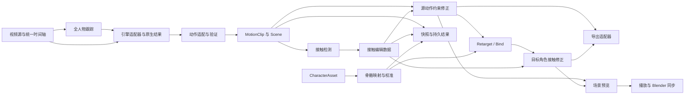

# zmocap 架构审查与 RGBMocap 能力扩展设计

审查日期：2026-11-14。代码基线：`f97e021d886746608b4d8cae9af67a9b8ea050ea`。
本文是审查结果与建议设计，不表示下述功能已经实现；本次没有改动运行代码。

## 1. 结论与边界

现有方向值得保留：把特征提取、解算、动作转换、角色处理拆成 ComfyUI 节点，CPU 中间结果可复用，three.js 本地预览，SMPL-X 原生预览作为数值参照。这些比搬入 RGBMocap 的桌面程序更适合 ComfyUI。

当前最需要改变的是三个基础约束：

1. “只出骨骼”改成“骨架动作是核心，原生参数、网格、相机是可选能力”。保留原生结果，才能支持相机对齐、网格 FBX、MAMMA 和 Blender 场景。
2. “ComfyUI 缓存代替工程”改成“执行缓存 + 持久结果清单”。缓存不能可靠保存人工编辑、跨服务重启恢复或模型间结果选择。
3. “一切都必须单环境、禁止 subprocess”需要重新评估。默认引擎继续进程内运行；Blender 是外部工具；确有冲突的引擎可提供显式可选 worker。若坚持单环境，必须接受一部分引擎暂不可用，不能为追求功能覆盖升级 ComfyUI 的全局 Torch/NumPy。

不要强制所有引擎走 `SMPL-X → SOMA → humanoid`。SOMA 可以保留为交换适配器；将其设为唯一通路会丢失原生关节、面部、形状和相机语义，而且当前方向法会损失 twist。VRM humanoid 是一种骨架配置，不是通用动作本身。

建议先完成“单人动作正确 → 绑定正确 → 接触编辑确实改变动作 → 导出可用”的闭环，再扩多人和多机位。PEAR 实时预览单独安排。

## 2. 审查范围与实际验证

- 检查本仓库 `nodes/`、`soma/`、前端入口与预览器、安装声明和现有测试；参考旧 `docs/HANDOVER.md`，重新核验关键结论。
- 读取本机 `B:\RGBMoCap`（WSL：`/mnt/b/RGBMoCap`）的 agent guide，以及重定向校准、脚底校准、求解、相机输入、FBX 导出、项目存储、骨骼串流等源码。在线核对 [D8mat/RGBMocap 仓库](https://github.com/D8mat/RGBMocap)。本机副本与 GitHub 当前 main 未做逐文件一致性证明，源码细节以本机副本为准。
- 8188 只读检查：ComfyUI `0.45.0`，前端 `1.59.1`，Python `3.13.5`，Torch `2.13.0+cu130`，RTX 4070 Laptop，约 8 GiB 显存；`/object_info` 注册 18 个 zmocap 节点。custom_nodes 下是指向本仓库的软链接。接口注册匹配不等于进程已加载每一项最新实现。
- 使用 `/home/tony/zvenv/comfyui/bin/python` 运行现有 `tools.test_retarget`：PASS，最大朝向误差 `4.005e-06°`。它验证合成骨链的 SMPL 绑定变换，不覆盖 SOMA、完整手指、真实角色或导出生态。
- 用零关节数组调用现有 BVH writer：每帧声明 **168** 通道，实际写出 **6** 个值。
- 用本机 SMPL-X 模板生成 SOMA 静止姿态，令 `world = rest`，再运行 `soma_to_vrm()`：相对于标准 humanoid rest，52 根骨最大偏差 **154.291893°**，中位数 **11.042199°**，42 根超过 5°。
- 实际调用骨名映射：`J_Bip_L_UpperArm → leftUpperArm`；`mixamorig:LeftArm`、`mixamorigLeftArm`、`hips`、`leftUpperArm` 都返回 `None`。这些结果特指 `soma.binding.humanoid_of`，不能推广到另一条 SMPL 绑定链。
- 没有排队 GPU 推理、重启服务、运行 RGBMocap、打开浏览器做交互验收，或执行 Blender/MMD/3ds Max 导入。本次验证不构成端到端精度或格式兼容认证。

## 3. 当前问题：按扩展前的修复优先级排序

| 优先级 | 代码证据 | 影响与建议 |
|---|---|---|
| P0 | `nodes/export.py:40` 强制读取 `joints/params`；`_bvh` 通道不足，旋转全零，关节树也不是可靠的 SMPL-X 定义 | 当前 BVH 不只是“简化版”，不能作为可用骨骼动画交付。先用真实 rest、parent、local rotation 写合法 BVH，再增加 preset；导出节点按能力验证输入 |
| P0 | `soma/vrm_motion.py:soma_to_vrm` 用动画方向直接构造规范骨架朝向，未将源 rest 方向基归一化 | 已复现静止输入偏转；先建立 rest 不变式，再处理 roll/twist，不能把现有公式注释当成证明 |
| P0 | `.gitignore` 排除整个 `vendor/`；`git ls-files vendor` 为空；依赖声明为空/注释；`soma/vrm.py` 顶层依赖 vendor MotionBridge | 新 clone 无法复现完整能力。增加锁定源码版本/哈希及安装流程，或按许可纳入必要源码；可选依赖延迟加载，不能让缺失的可选引擎阻断所有节点注册 |
| P1 | `nodes/track.py:69–78` 关联最大框，输出调用 `_pick(boxes)` 取首框；`_associate` 每帧最多一框 | “第 N 人”也没有可靠的多人语义；检测框应携带 id 与实际检测索引，关联全部检测，明确过期与遮挡策略 |
| P1 | `soma.binding` 骨名别名不完整，`_leg_length` 查 `LeftLeg/LeftFoot`，调用传入的却是角色原名或小写 humanoid 名 | 经常回退比例 1.0，位移缩放错误。优先读 VRM 扩展语义，统一 role→node 映射，并用髋膝踝完整链测比例 |
| P1 | SOMA 源使用 `Pinky`，`vrm_motion._BONES` 使用 `Little`；`write_humanoid_glb` 只写旋转动画 | 小指静止；无角色 humanoid GLB 丢失根位移。转换与写出需要逐字段保真测试 |
| P1 | `soma_to_vrm` 减掉第一帧髋位置；转换节点重建 dict，丢失来源、相机、接触等上下文 | 多人绝对布局与相机投影无法保持。把世界位姿与用户放置变换分开，原点重置应是显式操作 |
| P1 | `nodes/previewer.py` 内执行角色绑定；`retarget.build_glb` 的 broad except 吞掉 strict 失败 | 预览、绑定、导出无法复用同一结果，还可能显示替代骨架掩盖失败。独立 Bind 节点；strict 失败真正向上传播 |
| P1 | `nodes/exmr_engine.py:infer` 整序列 `.cuda()`，Runner.device 未实际使用；模型每阶段创建/删除 | README 的“显存归 ComfyUI 管、默认 32 帧/块”未完整落实。`empty_cache()` 不等于模型可卸载；预处理分批也不等于时序解算分块 |
| P1 | `motion` 三种表示字段不同，共用 `ZMOCAP_MOTION`，缺版本/坐标/时间统一验证 | 节点能连上却在运行中 KeyError。先定义公共 envelope + 能力声明和验证，不必把所有模型塞成相同关节数 |
| P2 | SMPL 原生预览文件 digest 只含帧数/fps；其他分支用数值绝对值之和及角色路径 | 相同帧数的不同动作会覆盖同一文件；数组和不是内容哈希，角色原地修改也无法区分。使用结果内容 id 与角色内容 id，并原子发布 |
| P2 | `nodes/frames_node.py` 临时帧目录由全局 `_KEEP` 持有；cleanup 没有在节点流程中形成生命周期 | 长视频和多人时磁盘持续增长；引入受管 ArtifactStore，执行中租约、可重建缓存和显式清理策略 |
| P2 | LoadVideo 输出 fps，但 Frames/特征不携带时间，Solve 有独立默认 30 fps；Intrinsics 重建 tracks 时丢 observed/person 等字段 | 容易静默错速与丢跟踪证据。时间轴随数据传递，修改内参保留其他字段；VFR 保留源 PTS 与重采样映射 |

旧交接报告的全部数值不能直接沿用：本次重新测得上述关键问题仍存在；其他旧问题应逐项重新测，不自动当成本次结论。

## 4. 总体架构



后端依赖方向为 `nodes → services → core`，引擎、文件格式、Blender 是 adapters；core 不导入 ComfyUI、GUI 或模型实现。前端展示动作和编辑状态，数值解算由后端纯函数完成。节点只做参数解析、验证、调度、进度与输出包装。

建议增量目录，不需要一次性搬空当前实现：

```text
core/          schema、时间、坐标、旋转、骨架、FK、接触、场景
services/      track、calibrate、retarget、correct、artifact、snapshot
engines/       base、exmr、gvhmr、flowhmr、mamma、prompthmr、pear
formats/       npz、bvh、glb、vmd、fbx
integrations/  blender、可选 worker 协议
nodes/         保留现有节点 id，逐步改为薄包装
web/js/        viewer、timeline、contact editor、scene editor、transport
tests/         数学不变式、契约、格式回读、缓存与编辑集成
```

将 `retarget.py` 的 GLB I/O、四元数、骨名映射、绑定、节点类拆开；把重复旋转工具收敛到一处。`soma/` 保留为兼容适配层。旧节点保持可加载，迁移时给出明确的版本与转换错误。

## 5. 数据契约：统一语义，保留原生表达

建议 Python 内用 dataclass/TypedDict + 验证器；磁盘 JSON 清单配 NPY/NPZ 数组，不引入强制大型框架。ComfyUI 自定义端口类型不负责校验，服务入口必须校验。

| 类型 | 核心字段与职责 |
|---|---|
| `VideoSource` / `FrameSource` | 内容 id、URI、宽高、源 PTS、分析 timestamps、source_frame_indices、裁切/缩放矩阵；按需读取，另提供 IMAGE 兼容入口 |
| `TrackSet` | 稳定 actor_id，逐人 bbox、检测置信度、observed/valid、缺失区间、时间轴和 camera_id；区分短缺失插值与未观测 |
| `MotionClip` | schema/version、clip_id、actor_id、时间轴、skeleton_id、坐标声明、rest_local、local_rotation、local_translation、valid、可选原生 params/camera/evidence 引用、provenance |
| `SkeletonSpec` | names、parent indices（根 -1）、语义 roles、rest transforms、长度/端点、可选蒙皮与 inverse-bind 引用；按真实骨架定义，拒绝闭环与未知父节点 |
| `CharacterAsset` | 文件内容 id、节点/蒙皮结构、角色空间 rest、世界变换、语义映射、几何引用；区分 node rest、skin bind 与用于显示的骨轴 |
| `CalibrationProfile` | 源/目标 skeleton id、角色内容 id、role 映射、共同参考、源去 bind、方向/twist offset、比例、脚底/掌面参考、版本及诊断 |
| `ContactSet` | 从现有 contact.v1 迁移，actor_id、effector role、[start,end)、权重、锁定位置/旋转、surface_id、来源与对应 clip id |
| `Scene` | 时间轴、actors 及 clip 引用、每人 placement、cameras、地面/道具及变换、当前结果选择 |
| `ArtifactRef` | 内容 id、相对路径、dtype/shape、schema、生成器版本与输入摘要；执行缓存只持有受管引用或 CPU 数据 |

明确约定：内部长度米、时间秒、右手 Y-up；引擎/摄像机原生坐标在入口显式换算。前向轴、矩阵乘法方向、局部/世界变换必须写入 schema；可选定内部人物前向 +Z，现有使用 -Z 的层通过适配器转换，不能只改标签。相机另声明 optical frame 与 `T_world_from_camera`，投影时求逆；外参、畸变、图像旋转/裁切映射必须齐全。

旋转存规范化 xyzw 四元数，插值使用最短弧，保持相邻符号连续；FK 用矩阵计算。不要对旋转矩阵逐元素平滑。`world/joints` 可作为派生缓存，不作为第二套可独立修改的真值。根位移必须包含绝对位置语义，`Scene.placement` 才处理“每人回原点”。

不要求模型原生参数可逆地变成通用骨架；`NativeResult` 始终保留。SMPL-X 形状、hand mean、关节索引与模型版本进入适配配置和缓存键，不能只从无形状模板推定所有演员骨长。缺手指/置信度/世界相机时显式标记 capabilities，禁止编造默认值后声称等价。

## 6. 八类能力的具体设计

### 6.1 绑定与重定向校准：部分已有，需独立成完整流程

节点建议：`Character Load → Map Skeleton → Calibrate Rig → Retarget`。输出分别为 CharacterAsset、映射、CalibrationProfile、目标 MotionClip；预览只消费结果。

优先 VRM 0/1 humanBones 语义，其次已知 Mixamo/BVH preset，最后名称启发式和用户映射。映射报告包含必需骨缺失、重复 role、左右反转、缩放、非均匀缩放与 unsupported bone；不能只报告匹配数量。

算法分层：源去 bind/归一化 → 共同参考 → 方向 swing + 原生姿态 twist/掌面与脚底参考 → 目标 rest 适配 → 转回目标 local → FK 验证。单根方向只能确定两个自由度，不能据此保证 roll 正确；退化时选择与方向最不平行的备用轴并保持时间连续。

对于已经处在同一坐标系、同一参考语义的旋转，基本关系可写为 `D(t)=R_source(t) @ R_source_ref.T`，`R_target(t)=D(t) @ R_target_ref`。方向驱动时应对动画帧和源参考帧使用同一构基函数，先求相对变化再映射到目标参考；不能直接套用公式跳过坐标和 twist 校准。按骨段处理参考，不能把静止中立姿态、首帧动作与 T-pose 混为一谈。

脚底方向使用中立网格 heel/toe/sole plane 或人工参考；骨骼模式允许 ankle→toe 的低精度 fallback，并在报告中标注。RGBMocap 的 `retarget/calibration.py`、`foot_calibration.py`、`pipeline.py` 说明它还有共同腿参考、表面几何及接触后修正，这些是当前缺口。可以借鉴数学和测试条件；其模块级全局状态、运行时 monkey patch 不宜直接放进 ComfyUI 进程。

验收：源参考姿态映射到目标参考；identity calibration 保持角色 rest；真实角色 A/T pose、转身、抬脚、腕部 twist、五指；骨长不变；SO(3) 合法；根位移可回读。不能要求任意角色在任意中立姿态下关节中心相同。

### 6.2 导出生态

统一 `ExportRequest(scene/clip, format, preset, options)`；同一个目标动作同时供预览、GLB、FBX 与烘焙，不能在每个 exporter 内重新绑定。

| 格式 | 实施方案 | 验收重点 |
|---|---|---|
| NPZ/NPY | 数组与 schema 清单，原生参数可选；配 Load Motion/Scene 节点 | 无 pickle 回读、版本迁移、相同内容 id |
| BVH | rest offsets + 完整 local Euler channels + root translation；Generic/Blender/Biped 独立 preset | 层级遍历顺序与通道逐项一致、旋转顺序/单位/轴转换、FK 回读误差；真实 Biped 导入另验 |
| GLB | 当前能力收敛到统一 writer，支持骨架/角色、多人和相机 | root motion、四元数连续、skin/inverse bind、重新加载一致 |
| FBX | 第一版可选 Blender 后台导出；另一方向是借鉴上游独立 FBX writer，评估维护成本后再做 | 有/无网格、骨轴、root motion、目标工具回读；明确 Blender 版本 |
| VMD | 目标是 PMX/MMD 语义映射，单独 MMD profile 与 IK 策略 | 日文骨名/CP932、坐标与缩放、足 IK 与手指、MMD 实际回放 |
| .blend | Blender 后台构造 source/target armatures、Actions、视频与相机、可选网格 | 素材打包/相对路径、全场景时间一致、重开可用 |

FBX 与 .blend 可共享 Blender 适配器，用 `blender --background` 执行参数列表和结构化请求文件；不安装第二个推理环境。所有导出写入临时文件，校验后原子发布，避免失败留下“完成文件”。支持首帧 T-pose 时同时平移 contacts/cameras/time metadata。

### 6.3 多人物

先让 TrackSet 真正保存同帧全部检测并稳定关联，再提供 `Select Actor` 和 `Solve Actors`。首版在一个明确的批处理节点中顺序解算，GPU 不同时驻留多人模型；不要依赖 ComfyUI 对 Python list 的隐式广播来表达场景。

Scene 保存 actor_id→clip 的映射、名称、颜色、placement 与选择状态。独立原点是场景/导出选项，保留原始世界位置。单目逐人恢复的深度/尺度未必处在可比较世界空间；相机/尺度不一致时标记 approximate placement，不能仅凭同一视频就宣称多人距离准确。遮挡后的身份不确定应可人工合并/拆分轨迹。

验收：同帧两人、交叉遮挡、进出画面、身份切换、缺失 mask、每人独立原点与整体场景两种导出。

### 6.4 接触编辑与真实修正

当前 Foot Contact 是检测并透传 motion；Contact Load 读取手改区间；光圈是显示层。修改区间不会自动重新执行 IK，不能视作已有完整 contact correction。

节点：`Detect Contacts → Contact Editor → Correct Motion`，角色绑定后可接 `Correct Target Contacts`。先做平地双脚，之后脚跟/脚趾、掌面、道具、人物间接触。源动作修正与目标比例变化后的接触保持是不同阶段，必须保留前后版本。

编辑器用节点 DOM 或 ComfyUI 内侧栏时间轴：拖区间、左右手脚轨道、撤销、锁定点/面与权重。小型 edits JSON 保存到可序列化 widget；大数组留 ArtifactStore。`source_clip_id + edits_hash + solver_version + calibration_id` 决定执行缓存。seek 和拖动只本地预览，提交编辑后才排队下游修正；编辑状态不能只放 `ui` 返回值或未序列化 DOM。

求解：原始证据检测 → 区间与锚点 → 有界 pelvis/root 调整 → 固定骨长腿/手臂 IK → 接触渐入渐出与残差报告。不可达时报告残差而非拉长骨头；不把修正后的足速再送回同一次接触检测形成自我强化。手接触要明确掌面朝向与目标 surface 的坐标。

现有 contact.v1 增加迁移器，保留原有 JSON/NPZ；编辑与快照绑定 motion 内容 id，错配必须可见。

### 6.5 多机位与场景相机

分两条：单机位世界相机/背景校正；多机位同步与联合解算。前者先做，能立即支持 Camera Preview 和视频投影对照。

`Camera Load/Estimate → Scene Camera` 输出 K、畸变、分辨率、逐帧外参、有效性及来源。屏幕叠加必须恢复原图与裁切的映射，报告重投影残差。背景校正优先形成独立 scene/camera transform，不默默改写原生预测。

`MultiView Inputs → Sync Views → Calibrate/Load Cameras → Associate Across Views → MultiView Solve`。输入保存每路原始 PTS、offset、采样映射；共同 timeline 不能靠“帧数相同”推定同步。MAMMA adapter 保留其原生相机与模型能力；没有可用 MAMMA 时可单独设计有标定关键点三角化基线，不能把两者称为等价。

读取 `mamma_inputs.py` 可确认上游支持校准输入验证、共同时间区间等机制；这不证明它能自动解决任意非同步视频。验收同步偏移、外参方向、单位、每视角切换、人体/相机投影和缺视角场景。

### 6.6 多引擎与资源管理

接口建议：`probe() / capabilities() / estimate_resources(request) / solve(request, progress, cancel) / to_motion(native)`；每个引擎的预处理 DAG 自己定义。Sapiens/SAM3D/HaMeR 特征只有在权重、裁切、归一化、版本兼容时才复用。

capabilities 至少区分原生骨架、手指、世界轨迹、动态相机、多人、多机位、流式。ExMR 保留拆分特征节点；补一个易用封装/子图入口，而不是废除已有可观察节点。建议接入顺序：ExMR 稳定 → GVHMR/FlowHMR 依赖验证后择一 → 其余离线引擎 → MAMMA → PEAR。SAM 跟踪是 tracker provider，不与姿态解算器混成同一种接口。

ComfyUI 内可管理的 torch 模型采用与本机 `ModelPatcher`/model_management 实际接口兼容的包装；仅有 `model_size()/load()` 两个函数不保证可用。先接管设备、装载、offload、异常释放、取消与显存估算，再讨论常驻复用。不再使用全局 `torch.hub.load` patch 或无范围限制的 sys.path 修改作为多引擎常规接口。

预处理按 batch 控显存；时序网络不能随意逐 32 帧截断，需要确认算法支持，再用重叠窗口、状态/边界处理与全片对照。长视频也需要按需解码和磁盘数组，300 帧 1080p float32 RGB IMAGE 本身约 6.95 GiB，解码堆栈复制会继续放大 RAM。

若启用可选 worker：版本化 JSON 协议 + 文件数组引用，结构化进度与错误，取消/超时/进程退出回收；交给统一 GPU lease 协调，明确外部 worker 不受 ComfyUI 自动显存回收控制。引擎可用性缺失时输出具体原因，不连带其他节点失败。是否放宽单环境原则是实施前的产品选择，本次不改变它。

### 6.7 Blender 联动

拆成三种服务：文件导出、离线动作播放/拖轴同步、实时捕捉。先做文件，再做离线同步。

ComfyUI 节点先发布不可变 motion/rig artifact；浏览器本地播放不重复执行节点。显式启用 bridge 后，通过带 token 的本机 WebSocket 或受限本机服务发送 rig 握手与 pose：actor_id、rig_id、scene revision、seek epoch、sequence、timestamp、变换约定。队列只保留最新显示帧，seek/换动作丢弃旧 epoch。addon 在 Blender 主线程 timer 更新骨架。

烘焙 Action 按完整帧区间读取 artifact，不能录制实时串流包代替烘焙，因为串流会丢帧。双向拖轴带来源标记避免反馈环。上游 `bone_stream.py` 的 rig hash、有限包长、latest-frame 与 Y→Z 转换值得参考；不能直接让浏览器访问原始 TCP，需适配传输。

### 6.8 工程化、恢复与合成 MP4

最小工程不是桌面项目系统：`workflow.json + manifest.json + edits/ + profiles/ + artifacts/`。manifest 保存输入内容 id/URI、actor 对应关系、各模型原生结果引用与当前选择、校准、接触编辑、相机、场景放置、版本；不保存环境绝对临时路径作为唯一依据。载入时验证文件与版本，缺少素材可重新定位。

ArtifactStore 以输入内容、模型/源码版本、参数、采样映射与 schema 版本组成 key；小型结果 NPZ、大序列 NPY/mmap。原子写入；成功结果不可变；缓存清理只清理本项目受管且没有被快照/执行租约引用的文件。提供 Save/Load Motion、Save/Load Scene Snapshot；ComfyUI 缓存负责减少执行，快照负责恢复。

合成 MP4 用离屏或受控后台渲染逐时间采样，与源视频按同一 timeline 合成，再由 FFmpeg 编码；支持音轨和裁切映射。浏览器录屏可做快速预览，但不能作为稳定离线导出的唯一方案。取消时回收自身临时产物，服务重启不误认半成品为成功结果。

## 7. 实施顺序与可验收交付

| 阶段 | 实施内容 | 完成条件 |
|---|---|---|
| A 基础正确性 | 合法 BVH、rest 归一化、骨名/小指/比例/root 修复、strict、依赖锁定；统一旋转与基线测试 | 新 clone 可按文档安装；静止/纯 root/手指样例通过；BVH 独立解析回读；原生 ExMR 基准不退化 |
| B 统一契约 | MotionClip/Scene/schema、时间与坐标、legacy adapter、ArtifactStore、Save/Load Motion | 现有节点 id 保持；错误连接给出可读报错；跨重启恢复；相同帧数不同动作不覆盖 |
| C 角色闭环 | 独立 Map/Calibrate/Retarget，预览消费产物，角色校准报告 | A/T pose、转身、足底、twist、位移、真实 VRM/GLB 验证 |
| D 编辑与交付 | contact editor + correction、Blender FBX/.blend、BVH presets、快照 | 编辑后仅下游重算；undo/保存恢复；固定骨长、足滑残差；目标工具实际回读 |
| E 场景与相机 | 全人物跟踪、逐人解算、Scene preview/placement、Camera Preview、离线 MP4 | 遮挡与身份测试、独立/整体原点导出、投影和多视角时间一致 |
| F 外延能力 | 逐个离线引擎、MAMMA、多视角、VMD、Blender bridge、PEAR 独立实时服务 | 每个适配器有依赖可用性和数值基线；实时启动/停止/取消/重连可控 |

阶段内部可按需求调整：VMD 若是主要使用场景，可在 D 单独推进；多人可在 B 后先做轨迹与容器。不要给未经依赖测试的引擎承诺固定接入日期。

首个里程碑应选 A+B 的最小纵向切片：ExMR 输出保留 → 统一 MotionClip → 保存/恢复 → 合法 BVH/GLB → 原生网格与骨架对照。随后推进校准和可用的接触修正，比同时新增多个模型节点更能提高交付质量。

## 8. 回归验证清单

- 数学：rest/reference 不变式，90°/180°旋转，各轴坐标往返，四元数连续与 det=+1，父子 FK，骨长不变。
- 保真：纯平移/纯旋转、五指、缺骨、A/T pose、带形状的源骨架、静止与动态脚底；保留原生参数和相机。
- 格式：BVH parser 回读并做 FK，GLB accessor/channel 与 root 检查；FBX/Blender/VMD 分别在真实目标工具验收。
- 数据：frame count/fps/timestamps、不同来源输入拒绝混用、contacts 绑定源内容、转换后 provenance 保留。
- 集成：同帧数不同动作、角色同路径内容更新、编辑撤销/重载、浏览器刷新、服务重启、取消/OOM、不完整 artifact 清理。
- 场景：两人交叉与短缺失、camera-to-world/world-to-camera、裁切投影、独立原点与全场景一致；多机位时间偏移。
- 资源：本机 8 GiB GPU 分阶段峰值、长视频 RAM/磁盘、offload 与工作流中其他模型共存；只有实际测试后才声明支持。

本次新增的是本文档。上述实现与新增回归测试均为后续工作，现有数值检查详见第 2 节。
